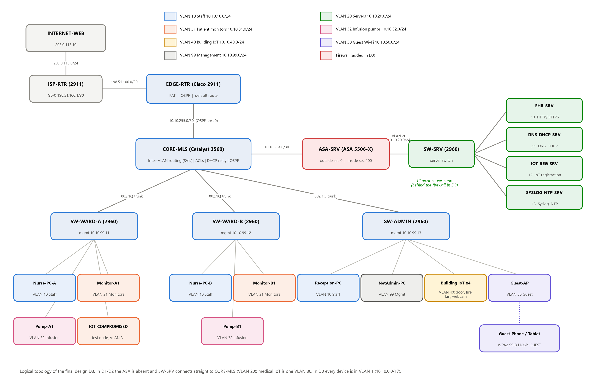

# Smart-Hospital Network: Containing Compromised Medical IoT with Segmentation

**CS2403 Computer Networks: Mini Project (Cisco Packet Tracer)** · RV University, School of CSE

> **Title:** *From Flat to Micro-Segmented: A Simulation-Based Evaluation of Lateral-Movement Containment for Compromised IoMT Devices in a Smart-Hospital Network*

This file is the team's guide. It explains what we built, why, how to build and test it in Packet Tracer, and every networking concept you may be asked about in the viva. Read sections 1–4 first. Use sections 5–6 while building and testing, and section 8 to prepare for the viva.

---

## Contents
1. [The project in one minute](#1-the-project-in-one-minute)
2. [What is in this folder / what is still to do](#2-what-is-in-this-folder--what-is-still-to-do)
3. [The network at a glance](#3-the-network-at-a-glance)
4. [The four designs (D0 → D3)](#4-the-four-designs-d0--d3)
5. [Building it in Packet Tracer](#5-building-it-in-packet-tracer)
6. [Packet Tracer gotchas](#6-packet-tracer-gotchas)
7. [Running the tests and recording results](#7-running-the-tests-and-recording-results)
8. [Every networking concept used, explained](#8-every-networking-concept-used-explained)
9. [Viva practice: questions and answers](#9-viva-practice-questions-and-answers)
10. [How this maps to the rubrics](#10-how-this-maps-to-the-rubrics)
11. [The research-paper route (fast-learner option)](#11-the-research-paper-route-fast-learner-option)
12. [Troubleshooting](#12-troubleshooting)

---

## 1. The project in one minute

**Problem.** Hospitals connect many medical IoT devices (patient monitors, infusion pumps) to the same network as staff PCs and the patient-records (EHR) server. These devices often run old firmware that cannot be patched. If an attacker takes over one of them in a **flat** network, they can move sideways (**lateral movement**) to the EHR server, to other medical devices, and to the switches and routers.

**What we do.** We build one realistic hospital network in Packet Tracer and save it as **four versions**. Only the **security policy** changes between them:

| Design | One-line summary |
|---|---|
| **D0 Flat** | Everything in one VLAN. Anyone can reach anyone. (Baseline) |
| **D1 VLAN-only** | Devices split into VLANs by role, but the core routes freely between them. |
| **D2 Zone ACLs** | D1 plus coarse ACLs: IoT may only talk to the *server zone*, and guests only to the Internet. |
| **D3 Micro-segmentation** | Each device class gets its own VLAN and may reach only the exact server and port it needs. Adds an ASA firewall, port security, DHCP snooping and SSH-only management. |

We then attack every design with the **same 7 attacks** from a "compromised IoT device" (a laptop), check that **9 normal hospital functions** still work, and compare:
- **RQ1:** how much of the network the attacker can still reach (attack surface),
- **RQ2:** whether normal hospital traffic still works,
- **RQ3:** what each design costs in configuration (lines, ACL entries, features).

**Expected headline result:** VLANs alone (D1) contain nothing. Coarse ACLs (D2) are a cheap, large improvement. Micro-segmentation (D3) blocks 5 of 7 attacks fully, but roughly triples the configuration effort. Two attacks remain *partial* because devices in the same VLAN can always reach each other, which leads to the future-work ideas.

---

## 2. What is in this folder / what is still to do

```
CN Project/
├── README.md                     ← this guide
├── plan.md                       ← original research plan
├── MiniProject Report.pdf        ← university report template (given)
├── RUBRICS FOR CIE 3 (1).pdf     ← marking rubrics (given)
├── CHECKLIST.md                  ← per-design checks + GUI-only steps
├── Cisco packet saves/
│   └── D0.pkt D1.pkt D2.pkt D3.pkt ← the 4 Packet Tracer files (built live)
├── configs/
│   ├── D0-flat/        *.txt     ← CLI configs, paste into each device
│   ├── D1-vlan/        *.txt
│   ├── D2-zone-acl/    *.txt
│   ├── D3-microseg/    *.txt     ← final design (includes ASA-SRV.txt)
│   ├── transitions/    *.txt     ← clean-up commands between designs (D0→D1, D2→D3)
│   └── END-DEVICES.md            ← PCs, servers, IoT, Wi-Fi, DHCP pools (GUI settings)
├── results/
│   ├── config-complexity.csv     ← MEASURED from the config files (real data)
│   ├── attack-matrix.csv         ← 180 rows: expected filled, "observed" for you to fill
│   ├── attack-surface.csv        ← 36 rows: same
│   └── functional.csv            ← 36 rows: same
├── report/
│   ├── CN_MiniProject_Report.docx← the report, in the template's layout
│   └── figures/                  ← topology + graphs (generated)
└── tools/
    ├── config_stats.py           ← counts config lines / ACEs / features
    ├── make_test_logs.py         ← creates the blank result sheets
    ├── make_graphs.py            ← draws graphs from the result sheets
    ├── draw_topology.py          ← draws the logical topology figure
    ├── build_report.js           ← regenerates the .docx report
    └── pt-extension/             ← cisco-pt-mcp bridge, BUILD-PLAN.md, push-plan/*.json (live build)
```

### Done
- Network design, addressing plan, and full CLI configs for all 4 designs (8 network devices).
- End-device settings (servers, DHCP pools, IoT, Wi-Fi, attack tools).
- Test plan (7 attacks, 9 functional tests), result spreadsheets with the expected outcome of every test.
- Complexity metrics (real, counted from configs), graphs, topology diagram.
- Report (.docx) in the RV University template: problem statement, introduction, diagram, every device's configuration, results structure, conclusion, references.
- **All 4 `.pkt` files built** (in `Cisco packet saves/`). Claude pushed every router/switch/ASA config live through the cisco-pt-mcp bridge. D0 is verified (OSPF FULL, default route via OSPF, LAN + Internet ping); the D3 ASA interfaces and OUTSIDE-IN ACL are verified.

### Still to do (by us, in Packet Tracer)
1. **Finish the GUI-only parts** in each `.pkt` (see `CHECKLIST.md`): server services, DHCP pools per design, IoT devices + registration, Guest-AP. Then run each design's checks. Section 5 explains how to rebuild by hand if ever needed.
2. **Run the tests** (section 7) and type what you see into the `observed` columns.
3. Run `python tools/make_graphs.py` to redraw the graphs from observed data, then rebuild the report.
4. **Take the screenshots** (report Figures 2–9) and paste them into the yellow boxes.
5. Fill in **names, USNs and the guide's name**. Search the report for yellow highlights and replace every one.
6. Check the expected-vs-observed tables. If Packet Tracer behaves differently from the prediction, **report what you observed** and explain why. That is a finding, not a failure.

> **Honesty rule.** The attack/surface numbers in the report are *expected values from design analysis*, and every chart says so. Before submitting, replace them with what you actually observed. Only `config-complexity.csv` is measured data already.

---

## 3. The network at a glance



```
                 INTERNET-WEB 203.0.113.10
                        |
                    ISP-RTR (2911)
                        | 198.51.100.0/30
                    EDGE-RTR (2911)       PAT, default route, OSPF
                        | 10.10.255.0/30   (OSPF area 0)
                    CORE-MLS (3560)       SVIs = gateways, ACLs, DHCP relay
        _______________|________________________________
       |  trunk         |  trunk         |  trunk        |  10.10.254.0/30 (D3)
  SW-WARD-A        SW-WARD-B         SW-ADMIN        ASA-SRV (D3 only)
  Nurse-PC-A       Nurse-PC-B        Reception-PC        |
  Monitor-A1       Monitor-B1        NetAdmin-PC      SW-SRV
  Pump-A1          Pump-B1           Door/Fire/Fan/Cam   ├ EHR-SRV        .10
  [test node]      [test node]       [test node]         ├ DNS-DHCP-SRV   .11
                                     Guest-AP ))) phone  ├ IOT-REG-SRV    .12
                                                         └ SYSLOG-NTP-SRV .13
```

### Addressing plan (10.10.&lt;VLAN&gt;.0/24, gateway is always .1)

| VLAN | Name | Subnet | Who lives there | Designs |
|---|---|---|---|---|
| 1 | flat | 10.10.0.0/17 (gw 10.10.0.1) | everyone | D0 only |
| 10 | STAFF | 10.10.10.0/24 | Nurse PCs, reception | D1–D3 |
| 20 | SERVERS | 10.10.20.0/24 | EHR .10, DNS/DHCP .11, IoT reg .12, Syslog/NTP .13 | D1–D3 |
| 30 | MED-IOT | 10.10.30.0/24 | all medical IoT | D1–D2 |
| 31 | MED-MONITORS | 10.10.31.0/24 | patient monitors | D3 |
| 32 | MED-INFUSION | 10.10.32.0/24 | infusion pumps | D3 |
| 40 | BLDG-IOT | 10.10.40.0/24 | door, fire monitor, fan, webcam | D1–D3 |
| 50 | GUEST | 10.10.50.0/24 | guest Wi-Fi | D1–D3 |
| 99 | MGMT | 10.10.99.0/24 | switch management IPs (.11–.13), NetAdmin-PC .50 | D1–D3 |
| 998 / 999 | NATIVE-UNUSED / BLACKHOLE | — | unused native VLAN / parked ports | D3 |

Point-to-point links use **/30** subnets (2 usable hosts): core–edge `10.10.255.0/30`, core–ASA `10.10.254.0/30`, edge–ISP `198.51.100.0/30`.

### Device list
| Device | Packet Tracer model | Role |
|---|---|---|
| ISP-RTR | 2911 | Simulated Internet provider |
| EDGE-RTR | 2911 | Internet edge: PAT, default route, OSPF |
| CORE-MLS | Catalyst 3560-24PS | Core: inter-VLAN routing, ACLs, DHCP relay, OSPF |
| ASA-SRV | ASA 5506-X | Stateful firewall in front of servers (D3) |
| SW-WARD-A / SW-WARD-B / SW-ADMIN | 2960-24TT | Access switches |
| SW-SRV | 2960-24TT | Server-room switch |
| 4 servers + INTERNET-WEB | Server-PT | EHR, DNS/DHCP, IoT registration, Syslog/NTP, public web |
| 4 PCs, 2 laptops (test tools), phone, tablet | PC-PT, Laptop-PT, Smartphone-PT, TabletPC-PT | End users / attacker |
| 8 IoT things | PT smart devices | Medical + building IoT |
| Guest-AP | AccessPoint-PT | Guest Wi-Fi (WPA2) |

Full port-by-port cabling is in the report (Table 3.2) and in every config file's `description` lines.

---

## 4. The four designs (D0 → D3)

Think of it as **one variable changed at a time**:

| | D0 Flat | D1 VLAN-only | D2 Zone ACLs | D3 Micro-seg |
|---|---|---|---|---|
| Broadcast domains in use | 1 | 6 | 6 | 7 (6 VLANs + server segment behind the ASA) |
| Can IoT reach EHR? | yes | yes | **yes** (whole server zone allowed) | **no** |
| Can IoT reach switches? | yes | yes | no | no |
| Can guests reach EHR? | yes | yes | no | no |
| Firewall | – | – | – | ASA, stateful |
| Layer-2 security | – | – | – | port security, DHCP snooping, BPDU Guard, trunk hardening |
| Management | Telnet, password `cisco` | Telnet | Telnet | SSH v2, local user, VLAN 99 only |
| Config lines (measured) | 189 | 274 | 302 | 571 |
| ACL entries (measured) | 1 | 1 | 17 | 52 |

**Why each step matters**
- **D0 → D1:** VLANs split the broadcast domains, but the multilayer switch routes between every VLAN it has an SVI for. Without filtering, VLANs are *organisation*, not *security*.
- **D1 → D2:** ACLs on the SVIs turn VLAN boundaries into security boundaries, but coarse ones. "IoT → server zone: permit any" still lets a hijacked pump browse the EHR.
- **D2 → D3:** *least privilege*. Monitors may only open TCP 80 to the IoT server. Nothing else, not even ping. The ASA checks again (defence in depth). Layer-2 controls stop rogue devices and rogue DHCP. SSH and VTY ACLs protect the infrastructure.

**What D3 still can't stop (honest residual risk):** devices *in the same VLAN* (e.g. two monitors in VLAN 31) can still reach each other at Layer 2, because ACLs on the SVI only see traffic that is *routed*. The IoT server must stay reachable because monitors need it. Fixes would be private VLANs, 802.1X/NAC, or SDN, which are our future work.

---

## 5. Building it in Packet Tracer

We used **Packet Tracer 9.0.1** (8.x also works). Build **D0 first**, save it, then **Save As** for each later design and modify it. That way the physical topology is identical (the controlled variable).

### Step 1: Place devices and cable them (D0)
1. Place every device from the [device list](#device-list) and **rename each one** (click the device → Config → Display Name) exactly as named here. The names appear in the report.
2. **CORE-MLS (3560-24PS):** works out of the box (no power module needed). Its uplink to EDGE is G0/1 (a routed port); the access-switch trunks use Fa0/1–3, which need `switchport trunk encapsulation dot1q`.
3. Cable as in report Table 3.2 (or use the lightning-bolt "automatic" cable):
   - EDGE-RTR G0/0 ↔ ISP-RTR G0/0 · ISP-RTR G0/1 ↔ INTERNET-WEB
   - EDGE-RTR G0/1 ↔ CORE-MLS G0/1
   - CORE-MLS Fa0/1, Fa0/2, Fa0/3 ↔ G0/1 of SW-WARD-A, SW-WARD-B, SW-ADMIN
   - CORE-MLS G0/2 ↔ SW-SRV G0/1
   - SW-SRV Fa0/1–4 ↔ EHR, DNS-DHCP, IOT-REG, SYSLOG-NTP servers
   - Ward switches: Fa0/1 nurse PC, Fa0/2 monitor, Fa0/3 pump, Fa0/4 (test-node port), Fa0/5 (spare staff jack)
   - SW-ADMIN: Fa0/1 Reception-PC, Fa0/2 NetAdmin-PC, Fa0/3–6 building IoT, Fa0/7 (test-node port), Fa0/8 Guest-AP
4. **IoT devices:** Advanced → I/O Config → Network Adapter → **PT-IOT-NM-1CFE** (wired), then cable them.

### Step 2: Configure network devices
Open each device → **CLI** tab → paste the matching file from `configs/D0-flat/`. Each file starts with `enable` / `configure terminal` and ends with `write memory`, so paste it whole. Paste a long file in 2–3 chunks if PT drops lines.

### Step 3: Configure end devices
Follow [`configs/END-DEVICES.md`](configs/END-DEVICES.md): server IPs and services, **DHCP pools for D0**, PCs on DHCP, IoT registration, Guest Wi-Fi.

### Step 4: Verify D0, then save
Run functional tests F1–F9 (section 7). When all pass, **File → Save As → `Cisco packet saves/D0.pkt`**.

### Step 5: D1 (Save As `D1.pkt`)
- Paste `configs/D1-vlan/` into CORE-MLS, SW-WARD-A/B and SW-ADMIN. **Tip:** on each switch, first run `erase startup-config` + `reload` (or just paste over the old config; the new file overrides every relevant line).
- On DNS-DHCP-SRV: change servers to /24 masks with gateway 10.10.20.1 and create the **D1/D2 pools** (END-DEVICES.md).
- NetAdmin-PC → 10.10.99.50/24, gateway 10.10.99.1.
- On every DHCP client: Desktop → IP Configuration → toggle **Static → DHCP** to get a new lease.

### Step 6: D2 (Save As `D2.pkt`)
Only CORE-MLS changes: paste `configs/D2-zone-acl/CORE-MLS.txt`. The access switches are identical to D1.

### Step 7: D3 (Save As `D3.pkt`)
1. Add **ASA 5506-X** (named ASA-SRV). Move the cable: CORE-MLS G0/2 ↔ **ASA G1/1**, and **ASA G1/2** ↔ SW-SRV G0/1.
2. Paste every file in `configs/D3-microseg/` (EDGE-RTR, CORE-MLS, ASA-SRV, 3 access switches).
3. DHCP server: replace pool MED-IOT with **MED-MONITORS (31)** and **MED-INFUSION (32)**.
4. Renew DHCP on all clients. Re-check IoT registration.
5. Note: **port security is sticky**, so each port learns the first MAC that sends traffic. Make sure the *legitimate* device on every port has sent something (a ping or a DHCP renew) **before** you run attack A6.

---

## 6. Packet Tracer gotchas

| Symptom | Fix |
|---|---|
| Trunk won't form on the 3560 (`Command rejected: An interface whose trunk encapsulation is "Auto"…`) | Run `switchport trunk encapsulation dot1q` **before** `switchport mode trunk` (the files already do). |
| Line after `no shutdown` seems ignored when pasting fast | PT's link-up console message can swallow the next line. Paste one interface block at a time and re-check with `show run`. |
| `% … overlaps with …` on the D0 Vlan1 IP | D0 must be /17 (255.255.128.0), not /16, or it overlaps the 10.10.255.0/30 core–edge link. |
| `crypto key generate rsa` asks a question | The files use `general-keys modulus 1024`, which needs no prompt. If PT still asks, type `1024`. |
| ASA rejects the inside IP | Run `no dhcpd enable inside` first (the factory DHCP pool is tied to 192.168.1.0/24). |
| ASA prompt asks for a password after `enable` | The factory enable password is blank: press Enter. |
| Pings fail at first, then work | ARP/OSPF/STP need a few seconds. Use **Fast Forward Time** or ping twice. |
| Client has a 169.254.x.x address | DHCP failed. Check the helper address, the pool's gateway, and (D3) DHCP snooping trust on the uplink. |
| IoT device not on dashboard in D3 only | Its registration port may not be TCP 80 in your PT version. See END-DEVICES.md §3 note. |
| Port shows err-disabled after you re-cable | Port security did its job. `shutdown` → `no shutdown` on that interface (and `clear port-security sticky` if needed). |
| A command is "Invalid" in PT but valid on real IOS | PT implements a subset of IOS. Note it as a limitation and continue. |

---

## 7. Running the tests and recording results

### The test node
**IOT-COMPROMISED** (a laptop) plays a hijacked medical device. Run every attack from **3 locations**, re-plugging its cable each time:
- **L1** SW-WARD-A Fa0/4 (medical IoT VLAN 30 / 31)
- **L2** SW-WARD-B Fa0/4 (medical IoT VLAN 30 / 31)
- **L3** SW-ADMIN Fa0/7 (building IoT VLAN 40)

After moving it, renew DHCP (toggle Static → DHCP) and note its new IP. Repeat each test **3 times**.

### Functional tests (must PASS in every design)
| ID | Do this | Pass if |
|---|---|---|
| F1 | Nurse-PC-A → Web Browser → `http://ehr.hospital.local` | EHR page loads |
| F2 | Nurse-PC-A → `ping 10.10.20.10` | replies |
| F3 | Browser → `http://10.10.20.12`, log in | all 8 IoT devices listed |
| F4 | `ipconfig` on PCs, IoT, phone | address in the correct subnet |
| F5 | Guest-Phone → `http://web.isp.test` | public page loads |
| F6 | Nurse-PC → `http://203.0.113.10`, then EDGE-RTR `show ip nat translations` | page loads, translation listed |
| F7 | NetAdmin-PC → `telnet 10.10.99.11` (D0–D2) / `ssh -l netadmin 10.10.99.11` (D3) | login works |
| F8 | Turn on smoke at Fire-Monitor (Alt+click / set its state) | HVAC-Fan turns on |
| F9 | SYSLOG-NTP-SRV → Services → SYSLOG | log entries from routers/core |

### Attacks (from IOT-COMPROMISED unless stated)
| ID | Attack | Exactly what to do | Expected D0/D1/D2/D3 |
|---|---|---|---|
| A1 | Recon sweep | Ping each of the **23 targets** (below). Count replies → `attack-surface.csv`. | S / S / P / P |
| A2 | EHR access | Web Browser → `http://10.10.20.10` | S / S / S / **B** |
| A3 | IoT hijack | Browser → `http://10.10.20.12` (login page) **and** ping a device of another class (e.g. Pump-A1) | S / S / S / P |
| A4 | Infra takeover | `telnet 10.10.99.11`, `telnet <own gateway>`, `telnet 10.10.255.1` (and `ssh -l netadmin …` in D3) | S / S / **B** / **B** |
| A5 | Rogue DHCP | Plug ROGUE-DHCP into SW-WARD-A Fa0/5; on Nurse-PC-A toggle DHCP; check whether its gateway became 10.10.10.66 | S / S / S / **B** |
| A6 | Rogue device | Unplug Monitor-A1, plug ROGUE-LAPTOP into SW-WARD-A Fa0/2, try to get an IP / ping | S / S / S / **B** |
| A7 | Guest pivot | From **Guest-Phone**: browser → `http://10.10.20.10` | S / S / **B** / **B** |

S = succeeded · P = partial (only some targets reachable) · B = blocked.

**The 23 A1 targets:** 4 staff hosts (Nurse-PC-A, Nurse-PC-B, Reception-PC, NetAdmin-PC), 4 servers (.10–.13), 4 medical IoT, 4 building IoT, 2 guest devices, 5 network devices (CORE-MLS gateway, EDGE-RTR 10.10.255.1, switches 10.10.99.11–13). Before testing, write the DHCP-leased IP of each host into the notes column.

**The 10 services counted for attack surface:** EHR HTTP, EHR HTTPS, IoT-server HTTP, DNS (`nslookup ehr.hospital.local 10.10.20.11`), Internet web server (an exfiltration path), plus Telnet/SSH on CORE, EDGE, and the three access switches.

**Expected attack surface:** D0 23/23 hosts & 10/10 services · D1 23 & 10 · D2 8 & 4 · D3 2 (L1, L2) or 4 (L3) & 1.

### Collecting evidence
- **Simulation mode** (bottom-right tab): run the attack, click the PDU with the red ✗, and open **Inbound/Outbound PDU details**. It names the dropping ACL. *This is your best screenshot.*
- `show access-lists` (CORE-MLS) and `show access-list OUTSIDE-IN` (ASA): **hit counters** prove which rules fired.
- `show port-security interface fa0/2`, `show interfaces status err-disabled`, `show ip dhcp snooping`, `show ip ospf neighbor`, `show ip route`, `show vlan brief`, `show interfaces trunk`.

### Turning observations into graphs and the report
```bash
pip install matplotlib                     # once
python tools/make_graphs.py --expected     # preview with predicted values (stamped "EXPECTED")
python tools/make_graphs.py                # real graphs, after all 'observed' cells are filled
python tools/config_stats.py               # re-count complexity if you edit any config
npm install docx                           # once
node tools/build_report.js                 # rebuild report/CN_MiniProject_Report.docx
```
> Rebuilding the .docx overwrites it. Paste screenshots and names **after** the final rebuild, or edit the text in `build_report.js` instead.

---

## 8. Every networking concept used, explained

Each concept: **what it is → how it works → where it is in our project → a likely viva question.**

### 8.1 Hierarchical / collapsed-core design
- **What:** Cisco's three-layer model is *access* (end devices plug in), *distribution* (policy, routing between VLANs) and *core* (fast backbone). Small sites merge distribution and core into one **collapsed core**.
- **Ours:** 2960s are the access layer. The 3560 is the collapsed core/distribution layer, where VLAN routing and ACLs live. EDGE-RTR is the WAN edge.
- **Viva:** *Why put ACLs on the core and not on every access switch?* All inter-VLAN traffic must pass the SVIs, so policy is enforced in one place.

### 8.2 Ethernet switching
- A switch learns **source MAC → port** into its MAC address table, forwards known unicast out one port, and **floods** broadcasts and unknown unicasts to every port in the same VLAN.
- **Viva:** *What is a broadcast domain?* The set of devices that receive each other's broadcasts. One VLAN = one broadcast domain.

### 8.3 VLANs (IEEE 802.1Q)
- **What:** Logical LANs on the same physical switches. Each VLAN is a separate broadcast domain and normally a separate IP subnet.
- **How:** An access port belongs to one VLAN (`switchport access vlan 10`). The switch keeps frames inside their VLAN.
- **Ours:** 6 VLANs in D1/D2, 8 in D3 (medical IoT split into monitors 31 / pumps 32).
- **Key insight:** VLANs isolate Layer 2 only. If a router or SVI routes between them, hosts can still talk at Layer 3. D1 proves this.
- **Viva:** *Valid VLAN range?* 1–4094 (1 is default; 1002–1005 reserved legacy). *Why not use VLAN 1?* It is the default everywhere, carries control traffic and is a common attack target, so D3 shuts SVI 1.

### 8.4 Trunking, native VLAN, DTP, VLAN hopping
- **Trunk:** one link carrying many VLANs. 802.1Q inserts a **4-byte tag** (TPID 0x8100 + 12-bit VLAN ID) into each frame.
- **Native VLAN:** frames on it travel **untagged**. Default is VLAN 1.
- **DTP:** Cisco protocol that auto-negotiates trunks. An attacker can pretend to be a switch and negotiate a trunk (**switch spoofing**).
- **Double-tagging attack:** if the attacker's access VLAN = native VLAN, they add two tags. The first switch strips the outer tag and the inner tag carries the frame into another VLAN.
- **D3 defences:** native VLAN moved to unused **998**, `switchport nonegotiate` (DTP off), `switchport trunk allowed vlan …` (only needed VLANs), unused ports in **VLAN 999** and shut down.
- **Viva:** *How does changing the native VLAN stop double tagging?* No user port is in VLAN 998, so no attacker frame can start in the native VLAN.

### 8.5 Inter-VLAN routing with SVIs
- **Options:** (1) a router port per VLAN (doesn't scale), (2) **router-on-a-stick** (subinterfaces on one trunk), (3) **SVIs on a multilayer switch**, which is fastest and what we use.
- **How:** `ip routing` enables routing. `interface Vlan10` + an IP makes the switch the default gateway for VLAN 10.
- **Ours:** CORE-MLS has SVIs 10/20/30/40/50/99 (D1/D2), and 10/31/32/40/50/99 (D3). The link to EDGE-RTR is a **routed port** (`no switchport`).
- **Viva:** *SVI vs routed port?* An SVI is a virtual L3 interface for a whole VLAN. A routed port is a physical port that behaves like a router interface (no VLAN).

### 8.6 IP addressing, subnetting, wildcard masks
- **RFC 1918 private ranges:** 10.0.0.0/8, 172.16.0.0/12, 192.168.0.0/16. We use 10.10.0.0/16, split by VLAN: `10.10.<VLAN>.0/24`, so the third octet tells you the VLAN.
- **/24** = 255.255.255.0 = 254 hosts. **/30** = 255.255.255.252 = 2 hosts (point-to-point links). **/17** = 255.255.128.0 = 32,766 hosts (D0's flat network; /17 not /16 so it cannot overlap the 10.10.254/255.x transit links, which IOS would reject).
- **Wildcard mask** = inverse of the subnet mask, used in IOS ACLs and OSPF: /24 → `0.0.0.255`, /30 → `0.0.0.3`. `0` bits must match, `1` bits are ignored.
- **ASA uses normal subnet masks** in ACLs, not wildcards (a classic exam trap).
- **Viva:** *Why /30 for router links?* Only 2 addresses are needed, which avoids wasting space. (/31 is also possible on modern routers.)

### 8.7 Static routing, default routes and OSPF
- **Static route:** written by hand (`ip route 10.10.20.0 255.255.255.0 10.10.254.2` on the core in D3 sends server traffic to the ASA). **Default route** `0.0.0.0/0` = "everything else" (EDGE → ISP).
- **OSPF:** a link-state **IGP**. Routers exchange LSAs, build an identical map, and run **Dijkstra's SPF** algorithm. Metric = cost (reference bandwidth / interface bandwidth). Administrative distance **110**. Neighbours form through **Hello** packets (every 10 s; dead after 40 s on Ethernet). Single **area 0** (backbone).
- **Our commands:** `router-id`; `network 10.10.0.0 0.0.255.255 area 0`; `passive-interface default` + `no passive-interface G0/1` (send Hellos only toward the edge router, never toward hosts, which is both safer and quieter); `default-information originate` on EDGE (advertises its default route to the core); `redistribute static subnets` on the core in D3 (tells EDGE about the server subnet behind the ASA).
- **Floating static routes (backup):** a static route with a *higher* administrative distance than OSPF stays out of the routing table until OSPF loses the route. Ours: `ip route 0.0.0.0 0.0.0.0 10.10.255.1 250` on CORE and `ip route 10.10.0.0 255.255.0.0 10.10.255.2 250` on EDGE. In `show ip route` you normally see `O*E2 0.0.0.0/0` (OSPF wins, AD 110 < 250); if OSPF breaks, `S*` appears instead and traffic keeps flowing.
- **Viva:** *Why OSPF and not RIP?* OSPF converges fast, uses cost instead of hop count, scales with areas, and is an open standard. *What is administrative distance?* How trustworthy a route source is: connected 0, static 1, OSPF 110, RIP 120. *What is a floating static?* A static route given AD 250 so it only takes over when the dynamic route disappears.

### 8.8 DHCP and DHCP relay
- **DORA:** **D**iscover (client broadcast) → **O**ffer → **R**equest → **A**ck. Client UDP **68**, server UDP **67**.
- **Problem:** broadcasts don't cross routers, but our DHCP server is in another VLAN.
- **Relay:** `ip helper-address 10.10.20.11` on each SVI turns the broadcast into a unicast to the server and writes the SVI's IP into the **giaddr** field. The server uses giaddr to **pick the right pool** (STAFF, GUEST, …).
- **ACL note:** the first DISCOVER comes from 0.0.0.0, so every inbound SVI ACL starts with `permit udp any any eq 67`.
- **Viva:** *How does one server serve six subnets?* Relay plus giaddr-based pool selection.

### 8.9 DNS
- Resolves names to IPs (UDP **53**). Our server holds A records: `ehr.hospital.local`, `iot.hospital.local`, `web.isp.test`. Test F1 uses a name, so it checks DNS and HTTP together.

### 8.10 NAT / PAT
- **Why:** private 10.x addresses are not routable on the Internet.
- **PAT (NAT overload):** many inside hosts share **one** public IP. The router tells flows apart by **source port number**. Terms: *inside local* (10.10.10.101), *inside global* (198.51.100.2).
- **Ours (EDGE-RTR):** `ip nat inside` / `ip nat outside` on the interfaces, `access-list 1` selects 10.10.0.0/16, `ip nat inside source list 1 interface G0/0 overload`.
- **Viva:** *Why doesn't ISP-RTR need a route to 10.10.0.0/16?* Every packet it sees comes from 198.51.100.2, which is directly connected.

### 8.11 Access Control Lists (ACLs)
- **Standard ACL** (1–99): matches **source IP only**. Place it near the **destination**. We use one for VTY access (`access-list 10`) and one to select NAT traffic.
- **Extended ACL** (100–199 or named): matches **protocol, source, destination and port**. Place it near the **source**. All our zone and micro-segmentation ACLs are named extended ACLs.
- **Rules:** processed **top-down, first match wins**, with an **implicit `deny ip any any`** at the end. One ACL per interface, per direction, per protocol.
- **Inbound on an SVI** = filters traffic *leaving* that VLAN (entering the router from hosts). This is how we stop a compromised device at its own gateway, as close to the source as possible.
- **`access-class 10 in`** on `line vty` filters who may *log in to the device itself*.
- **Directional ICMP trick (D3):** `permit icmp … 10.10.99.0 … echo-reply` lets admins ping IoT devices, while IoT devices cannot *start* a ping (no `echo` permitted).
- **Viva:** *Why does D2 still let IoT reach the EHR?* Its ACL permits the whole 10.10.20.0/24 zone on any port. D3 permits only `host 10.10.20.12 eq 80`.

### 8.12 Stateful firewall: Cisco ASA
- **Stateless ACL** (router) checks each packet on its own. A **stateful firewall** keeps a **connection table**: once an allowed connection starts, its return packets are allowed automatically.
- **Security levels** (0–100): traffic from **higher → lower** (inside 100 → outside 0) is allowed by default. **Lower → higher** is denied unless an ACL on the lower interface permits it.
- **Ours:** `outside` (sec 0, facing the core) and `inside` (sec 100, servers). `access-group OUTSIDE-IN in interface outside` lists every permitted campus → server flow. `inspect icmp` makes ping replies stateful.
- **Defence in depth:** the core ACL *and* the ASA must both allow a flow. A mistake in one layer is caught by the other.
- **Viva:** *Why put the servers behind a firewall when the core already has ACLs?* Defence in depth, stateful tracking, and a separate policy point for the most valuable assets.

### 8.13 Port security
- Limits which MACs may use an access port. `maximum 1` + `mac-address sticky` (learn the first MAC and save it in the config) + `violation shutdown` (an unknown MAC **err-disables** the port).
- **Violation modes:** *protect* (drop silently), *restrict* (drop + log + count), *shutdown* (disable the port; the default).
- **Ours:** every D3 access port. The staff wall jack allows 2 MACs; the guest-AP port allows 10 with *restrict* (wireless clients appear behind it).
- **Defeats:** attack A6 (unplug a monitor and plug in a laptop), and MAC flooding.

### 8.14 DHCP snooping
- The switch marks ports **trusted** (uplinks toward the real server) or **untrusted** (users). **DHCP OFFER/ACK from untrusted ports are dropped**, which defeats **rogue DHCP servers** (attack A5: the rogue tries to become everyone's gateway for a man-in-the-middle).
- It also builds a **binding table** (MAC–IP–port–VLAN) that Dynamic ARP Inspection and IP Source Guard can use (future work).
- `no ip dhcp snooping information option`: by default the switch inserts **option 82** with giaddr 0.0.0.0, which the relay drops. We disable insertion.

### 8.15 Spanning Tree, PortFast, BPDU Guard
- **STP (802.1D; Cisco runs PVST+, one tree per VLAN)** blocks redundant paths to prevent **switching loops** (broadcast storms). It elects a root bridge, and ports go through listening and learning states before forwarding (about 30 s).
- **PortFast:** an edge port skips straight to forwarding (hosts can't cause loops).
- **BPDU Guard:** if a PortFast port ever receives a BPDU (someone plugged in a switch), it is **err-disabled**. This stops rogue switches and root-bridge hijacking.

### 8.16 Secure management: SSH, local users, VTY ACLs
- **Telnet** (TCP 23) sends everything, including passwords, in **cleartext**. **SSH v2** (TCP 22) encrypts the session.
- SSH prerequisites on IOS: **hostname + `ip domain-name` + RSA key (`crypto key generate rsa`, ≥768 bits for SSHv2) + a local user**. Then `transport input ssh` and `login local`.
- `service password-encryption` hides type-7 passwords in the config; `enable secret` uses a hash. A banner gives legal notice, and `exec-timeout` closes idle sessions.
- **Management VLAN 99** + `access-class 10 in` = only admins can even try to log in.

### 8.17 Syslog and NTP
- **Syslog** (UDP 514): devices send events (link up/down, ACL hits, port-security violations) to a central server, which is essential for spotting an attack. Severity levels 0 (emergency) to 7 (debug).
- **NTP** (UDP 123): synchronises clocks so log timestamps from different devices can be correlated. `service timestamps log datetime msec`.

### 8.18 Wireless (WPA2-PSK)
- The AP **bridges** wireless clients into VLAN 50. **SSID** = network name. **WPA2-PSK** = AES-CCMP encryption with a shared passphrase (WPA2-Enterprise would use 802.1X/RADIUS per user).
- Guest isolation is enforced by the VLAN + `GUEST-IN` ACL (Internet only).

### 8.19 IoT in Packet Tracer
- Smart devices register with an **IoT registration server** (our IOT-REG-SRV) over the network. The web dashboard (HTTP) shows devices and runs **automation rules** (smoke → fan).
- In D3 they get exactly one permission: TCP 80 to 10.10.20.12.

### 8.20 Security concepts behind the research
- **Lateral movement:** after the first foothold, the attacker hops to other systems inside the network.
- **Attack surface:** everything an attacker can reach. We measure it as % of hosts and services reachable.
- **Least privilege:** grant only the minimum access needed (D3's ACLs).
- **Zero Trust (NIST SP 800-207):** "never trust, always verify". Location inside the network grants no trust.
- **Segmentation vs micro-segmentation:** zones (D2) vs per-device-class, per-port policy (D3).
- **Defence in depth:** several independent layers (L2 controls + SVI ACL + ASA + device hardening).
- **Residual risk:** what remains after controls (same-VLAN traffic, required services).

### 8.21 Quick port & protocol cheat-sheet
| Protocol | Transport / port | Used for |
|---|---|---|
| HTTP / HTTPS | TCP 80 / 443 | EHR web, IoT dashboard, Internet |
| DNS | UDP 53 | name resolution |
| DHCP | UDP 67 (server) / 68 (client) | addressing |
| Telnet / SSH | TCP 23 / 22 | device management |
| Syslog | UDP 514 | logging |
| NTP | UDP 123 | time |
| OSPF | IP protocol 89 | routing |
| ICMP | IP protocol 1 | ping / traceroute |

### 8.22 Which OSI layer is each thing on?
| Layer | In this project |
|---|---|
| 1 Physical | copper cables, Wi-Fi radio |
| 2 Data link | Ethernet, MAC tables, VLANs, 802.1Q, STP, port security, DHCP snooping, WPA2 |
| 3 Network | IP, subnets, SVIs, static/OSPF routing, ACLs, NAT, ICMP |
| 4 Transport | TCP/UDP ports matched by extended ACLs; ASA connection tracking |
| 7 Application | HTTP, DNS, DHCP, SSH, Syslog, NTP, IoT registration |

---

## 9. Viva practice: questions and answers

1. **What problem does your project solve?** It contains a compromised medical IoT device so it cannot reach patient records or take over the network, and it measures how much each level of segmentation helps.
2. **Why four designs?** To isolate the effect of each control. Only the security policy changes, so the differences in results are caused by the policy.
3. **Why a laptop as the compromised device?** PT IoT devices can't run ping, browser or Telnet attacks. A laptop in the IoT VLAN behaves like a hijacked device at the network level.
4. **Do VLANs provide security?** On their own, no. They separate Layer 2, but a Layer-3 device routes between them. Security needs ACLs or a firewall at the routing point (D1 vs D2).
5. **What is an SVI?** A virtual Layer-3 interface for a VLAN on a multilayer switch, acting as that VLAN's default gateway.
6. **Explain `ip helper-address`.** It relays DHCP broadcasts as unicast to a server in another subnet and adds giaddr so the server picks the right pool.
7. **Standard vs extended ACL?** Standard matches source only (place near the destination). Extended matches protocol, source, destination and ports (place near the source).
8. **What is at the end of every ACL?** An implicit `deny ip any any`.
9. **Why is `permit udp any any eq 67` the first line of each SVI ACL?** The DHCP Discover is sent from 0.0.0.0 to 255.255.255.255. Without that line, clients never get an address.
10. **Wildcard for 10.10.31.0/24?** `0.0.0.255`.
11. **How does the ASA decide what to allow?** Security levels (high → low allowed), the ACL on the interface for low → high, and a stateful connection table for return traffic.
12. **Why does the ASA need `inspect icmp`?** Without it, ICMP echo-replies are not tracked as return traffic, so permitted pings fail.
13. **What does port security protect against?** Unauthorised devices on a port, MAC spoofing and MAC flooding. Our setting err-disables the port.
14. **What is a rogue DHCP attack and how is it stopped?** An attacker's DHCP server hands out itself as gateway/DNS (man-in-the-middle). DHCP snooping drops server messages on untrusted ports.
15. **What is VLAN hopping?** Reaching another VLAN through switch spoofing (DTP) or double tagging. Defences: `nonegotiate`, unused native VLAN, allowed-VLAN lists.
16. **Why SSH over Telnet?** Telnet is cleartext. SSH encrypts and authenticates.
17. **What does `passive-interface default` do?** It stops OSPF Hellos on every interface except the ones you re-enable, so hosts can't see or join OSPF.
18. **Why `default-information originate`?** So EDGE-RTR advertises its default route to the core via OSPF; the core doesn't need a static default.
19. **What is PAT?** Many private hosts share one public IP, told apart by port numbers.
20. **Why does D3 still show "partial" for recon?** Hosts in the *same* VLAN talk at Layer 2 without passing the SVI, so the ACL never sees that traffic. Fix: private VLANs or 802.1X.
21. **What did segmentation cost?** Measured: 189 → 571 config lines, 1 → 52 ACEs, 0 → 12 security features.
22. **What would you recommend to a small hospital?** Zone ACLs + least privilege for the EHR + Layer-2 hardening on IoT ports. That gives most of D3's benefit for less effort ("minimum viable segmentation").
23. **What are the limitations?** PT is a simulator: no real exploits, approximate timing, a subset of IOS features, and a laptop stands in for the IoT attacker.
24. **Future work?** Private VLANs, 802.1X/RADIUS NAC, Dynamic ARP Inspection, SDN that isolates a device automatically when an IDS flags it.
25. **Why does D3 put monitors and pumps in different VLANs?** They are different device classes with different risk, and splitting them stops a hijacked monitor from reaching pumps (cross-class lateral movement).

---

## 10. How this maps to the rubrics

| Rubric item | Marks | Where we cover it |
|---|---|---|
| Report submission | 5 | `report/CN_MiniProject_Report.docx`: every template section, all device configs with comments, tables, figures, discussion, references |
| Project demonstration | 5 | 4 working `.pkt` files. Live demo: same attack on D0 (works) vs D3 (dropped, shown in Simulation mode) |
| Presentation & viva | 5 | Sections 8–9 of this README; every member should be able to explain any design |
| Lab: understanding of problem | 2 | Problem statement + research questions |
| Lab: execution, all test cases | 2 | 9 functional + 7 attack tests × 4 designs × 3 locations × 3 trials |
| Lab: documentation with comments & outputs | 2 | Commented configs, CSV data sheets, screenshots |
| Viva: concepts / communication | 4 | Section 8 concept notes |

**Suggested split of work (adapt to team size 2–4):**
- **Member 1:** topology build, EDGE/CORE/ASA configs, routing/NAT/OSPF explanation.
- **Member 2:** access switches, Layer-2 security (port security, DHCP snooping, STP), attacks A5/A6.
- **Member 3:** servers, DHCP/DNS, IoT and Wi-Fi, functional tests.
- **Member 4:** test runs A1–A4/A7, data sheets, graphs, report assembly.

Everyone should still be able to explain **all** of section 8.

**Demo script (5 minutes):**
1. Show the D3 topology and VLAN colours.
2. Nurse-PC opens the EHR (it works).
3. IOT-COMPROMISED opens the EHR in D0 (it works), then in D3 (dropped; show the PDU details naming `MONITORS-IN`).
4. Plug ROGUE-LAPTOP into Fa0/2 and show the port going err-disabled.
5. Show the complexity-vs-security graph.

---

## 11. The research-paper route (fast-learner option)

The course allows fast learners to write a **research paper** based on recent networking publications instead of only the standard project. The conditions (from the course notice):
- It **requires prior approval from the faculty**.
- **Maximum 2 students** in the group.
- **The faculty member must be one of the authors.**
- The final paper must be **communicated to a journal or conference before CIE-3**.

(The other fast-learner option is a hardware network project in the Networks lab.)

This project is designed to grow into that paper. The Packet Tracer testbed, the 4-design controlled comparison and the measured data are its core. **Do this first:** show `plan.md` and this README to the faculty guide, get approval, and agree on authorship and the target venue (they will know which conferences and journals are suitable and their deadlines).

**Paper outline** (from `plan.md`): Abstract → Introduction (IoMT threats, healthcare ransomware) → Related Work (micro-segmentation, Zero Trust, earlier PT studies) → Methodology (topology, 4 designs, 7 attacks, metrics) → Results (heatmap, attack-surface chart, complexity-vs-security) → Discussion ("minimum viable segmentation") → Limitations → Conclusion and future work.

**Before writing Related Work**, do a proper literature search (IEEE Xplore, ACM DL, Scopus, Google Scholar) on: *IoMT security, hospital network segmentation, micro-segmentation, zero trust healthcare, lateral movement, Packet Tracer security evaluation*. Cite only papers you have read.

---

## 12. Troubleshooting

| Problem | Check |
|---|---|
| Nothing routes between VLANs | `show ip interface brief` (SVIs up/up?), `ip routing` present, at least one active port in that VLAN |
| Trunk not forming | `show interfaces trunk`; in D3 both ends need the same native VLAN (998) |
| No Internet | `show ip ospf neighbor` (FULL?), `show ip route` on core has `O*E2 0.0.0.0/0`, NAT inside/outside on the correct interfaces |
| D3: staff can't reach EHR | Core `show access-lists STAFF-IN` counters; ASA `show access-list`; ASA route back to campus (`route outside 0 0 10.10.254.1`); core static route to 10.10.20.0/24 |
| D3: DHCP fails | Uplink has `ip dhcp snooping trust`; `no ip dhcp snooping information option`; ASA permits UDP 67 to .11 |
| SSH refused from NetAdmin | NetAdmin must be in VLAN 99 (10.10.99.50); `show ip ssh`; RSA key generated? |
| Port err-disabled | `show port-security`, then `shutdown` / `no shutdown` on the interface |
